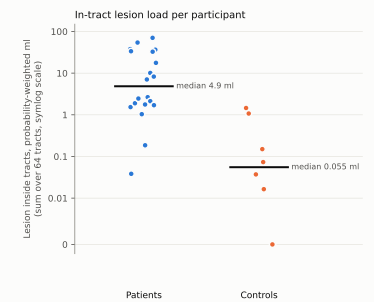
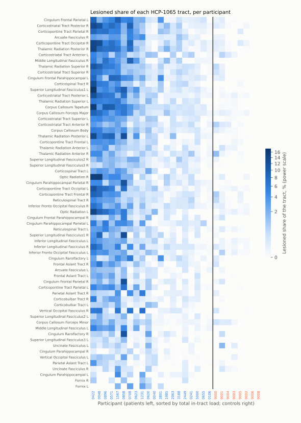
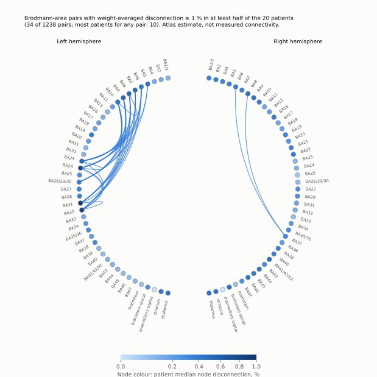

# ms-lesion-networks

An open, reproducible pipeline that segments white-matter lesions in the public
multiple sclerosis dataset **OpenNeuro ds007908**, measures how much of each major
white-matter tract the lesions overlap, and maps that tract damage onto pairs of brain
regions through a published population atlas.

> **Nothing in this repository is evidence about multiple sclerosis.** It is a
> software pipeline and a description of one small public dataset (20 patients,
> 8 controls, baseline only). It makes no diagnostic or clinical claim.

## Status (2026-11-23)

1. Fetch T1w + FLAIR for all 28 participants (`scripts/01_fetch_anat.sh`): done.
2. Lesion segmentation with LST-AI v2.0.0rc1 (`scripts/02_run_lst_ai.sh`, `resume.sh`,
   `status.sh`): done for 28 of 28.
3. Lesion-to-tract overlap against the HCP-1065 population tract atlas
   (`scripts/03_tract_overlap.py`): done, `derivatives/tract_overlap.tsv`.
4. Atlas network step (`scripts/04_network.py`): done, `derivatives/network_*.tsv`.
5. Figures (`scripts/05_figures.py`) and this write-up: done.

## What was measured

**Tract overlap.** For every participant, LST-AI's MNI-space lesion mask is resampled
onto the grid of the HCP-1065 population-probability tract atlas (Yeh 2022, 64 tracts).
Two numbers per tract:

- `lesion_ml`: lesion volume inside the tract, each voxel weighted by the atlas
  probability that the tract passes through it;
- `tract_fraction`: that volume divided by the tract's own probability-weighted volume,
  the share of the tract that is lesioned.

`derivatives/tract_overlap.tsv` is long format, one row per participant and tract
(28 × 64 = 1,792 rows), with the group, age and sex columns from `participants.tsv`.
LST-AI aligns each brain to its MNI template rigidly (6 degrees of freedom), so "MNI
space" here means rigidly aligned, not nonlinearly normalised; the atlas is placed on
that brain by world coordinates.

**Network step: what the atlas can and cannot support.** The resource is Yeh's
population-based tract-to-region connectome (Yeh F-C, Nat Commun 13:4933, 2022), as
published on the HCP-1065 atlas page: spreadsheets of cortical regions × 52 tracts
(26 per hemisphere), each entry the share of 1,065 HCP young adults in whom the tract
reaches the region, for the Brodmann (39 areas), Kleist (49) and HCP-MMP (180)
parcellations. It is a tract-to-region table. It has no region-to-region entries,
does not say which of a tract's regions a given fibre joins, and leaves out
commissural, cerebellar and brainstem pathways and subcortical regions. **A
per-connection disconnection estimate cannot be read off it,** so this repository does
the fallback instead: a tract → region-pair mapping of the overlap above
(`lesionnet/connectome.py`):

- an association tract that reaches regions *i* and *j* (same hemisphere) with
  probabilities *p<sub>i</sub>* and *p<sub>j</sub>* is taken to carry the pair (*i*, *j*)
  with weight *p<sub>i</sub>·p<sub>j</sub>*. "Carry" means both regions are reached by
  the tract, not that a fibre is known to join them;
- a projection tract (corticospinal, corticobulbar, corticostriatal, corticothalamic,
  optic radiation, fornix) carries (cortical region, the tract's subcortical target)
  with weight *p<sub>i</sub>*. The targets (brainstem/spinal cord, brainstem, striatum,
  thalamus, mammillary bodies/septum) are textbook labels added here, not part of the
  atlas;
- entries under 5 % are dropped, the cut-off below which the paper leaves them blank.

A pair's **disconnection** for one participant is the weight-averaged `tract_fraction`
of the tracts that carry it: a pair carried by one tract inherits that tract's lesioned
share, a pair carried only by unlesioned tracts scores 0. A region's (node's)
disconnection is the same average over all pairs it belongs to. A pair or node counts as
*hit* at ≥ 1 %. Both parcellations used here are written to the same files
(`parcellation` column): Brodmann, 1,238 region pairs, and HCP-MMP, 15,936.

- `derivatives/network_participants.tsv`: per participant and parcellation, lesion in
  the 52 mapped tracts (`mapped_lesion_ml`) and in the 12 the connectome leaves out
  (`unmapped_lesion_ml`: corpus callosum ×4, corticopontine ×6, reticulospinal ×2),
  pairs hit, weighted mean and maximum pair disconnection, and the most affected pair;
- `derivatives/network_regions.tsv`: per participant, parcellation and node;
- `derivatives/network_pairs.tsv`: per pair, the patient and control medians and the
  number of patients and controls in whom it is hit.

## Numbers, stated as what they are

These are descriptive numbers from one segmenter (LST-AI v2.0.0rc1) on 28 people at a
single timepoint. They are not tested, not corrected, not compared with any outcome
(ds007908 ships no clinical or cognitive scores), and the network numbers are an atlas
estimate on top of that, not a measurement of anyone's connectivity.

<picture>
  <source media="(prefers-color-scheme: dark)" srcset="figures/load_dark.svg">
  
</picture>

**Tract overlap.** Summed over all 64 tracts, patients (n = 20) carry 0.04 to 70.4 ml
of lesion inside tracts, median 4.9 ml, and eight of them more than 10 ml. Controls
(n = 8) carry 0 to 1.5 ml, median 0.06 ml; two controls have no lesion voxel in any
tract. The segmenter therefore reports something on most controls too, which is a
property of the segmenter on this data (see the bidsgate result below), not a finding
about the controls. (An earlier version of this README gave the medians as 7.1 and
0.07 ml; those were wrong, the table has always said 4.9 and 0.06.)

The tracts with the highest median lesioned share among patients, with the number of
patients in whom more than 1 % of the tract is lesioned:

| Tract | Patient median share | Control median | Patients > 1 % |
|---|---|---|---|
| Cingulum frontal-parietal L | 0.99 % | 0.000 % | 10 of 20 |
| Corticostriatal tract posterior R | 0.83 % | 0.000 % | 9 of 20 |
| Corticopontine tract parietal R | 0.79 % | 0.000 % | 9 of 20 |
| Arcuate fasciculus R | 0.71 % | 0.000 % | 9 of 20 |
| Corticopontine tract occipital R | 0.63 % | 0.004 % | 7 of 20 |
| Thalamic radiation posterior R | 0.61 % | 0.000 % | 9 of 20 |
| Corticostriatal tract anterior L | 0.61 % | 0.002 % | 6 of 20 |
| Middle longitudinal fasciculus R | 0.61 % | 0.000 % | 9 of 20 |

The periventricular tracts dominating the list is what the anatomy of MS lesions would
predict, which is the least interesting thing a number can be.

<picture>
  <source media="(prefers-color-scheme: dark)" srcset="figures/heatmap_dark.svg">
  
</picture>

**Network step (Brodmann).** 15 of 20 patients have at least one region pair hit
(≥ 1 %); the median patient has 173 of 1,238 pairs hit (range 0 to 1,074), and the
largest single pair disconnection is 17 % (one patient, left BA1/3 to left BA23). Two of 8
controls have any pair hit (6 and 82 pairs), each from under 1 ml of segmented lesion.
The number of pairs hit follows total in-tract lesion load almost one to one across
participants, so it is mostly a re-expression of lesion load through the atlas, not new
information. A median of 34 % of each patient's in-tract lesion load (range 17 to 47 %)
falls in the 12 tracts the connectome does not cover and contributes to no pair.
Thirty-four pairs are hit in at least half of the patients and in none of the controls;
32 of them are left-hemisphere pairs, and almost all are carried by the left frontal-
parietal cingulum, the one tract lesioned beyond 1 % in exactly 10 of 20 patients. The
nodes with the highest patient median disconnection are left BA31, BA32 and BA24
(0.8 to 0.9 %). With HCP-MMP the same 15 patients and 2 controls have a pair hit.

<picture>
  <source media="(prefers-color-scheme: dark)" srcset="figures/network_dark.svg">
  
</picture>

## How much to trust the segmenter on this data

The same LST-AI image was run through [bidsgate](https://github.com/CedricConday/bidsgate)
on six of these controls with twelve synthetic lesions injected each: it found 64 of 72
(mean Dice 0.82), and seven of the eight misses were among the lowest-placed lesions in
their subject, at cerebellum and brainstem level. Extra components on controls ranged
from 2 to 32 per subject. Read the tract numbers with that in mind: supratentorial
tracts are well covered, infratentorial ones less so, and small control volumes may be
real incidental hyperintensities or segmenter noise; the gate cannot tell.

## Limitations

- **Small and single.** 28 people, one session, one scanner protocol, one segmenter,
  no manual reference segmentation. Every number above inherits the segmenter's errors.
- **No outcome.** Nothing here is related to disability, cognition or disease course;
  the dataset carries none of those.
- **Atlas, not individual anatomy.** Tracts and tract-to-region probabilities come from
  1,065 healthy young adults, not from these participants' own diffusion data, and are
  placed on a rigidly aligned brain. Lesion-driven or age-related displacement is not
  modelled.
- **Region pairs are co-innervation, not connections.** The connectome says which
  regions a tract reaches. Two regions on the same end of a tract count as a pair, and
  the mapping cannot say where along the tract a lesion sits relative to any pair.
  Yeh notes that some tract-to-region entries are fibres passing by, not terminating.
- **Coverage.** The connectome omits commissural, cerebellar and brainstem pathways and
  has no subcortical rows; a third of the patients' in-tract lesion load is outside it.
  The subcortical targets of projection tracts are labels added here.
- **Thresholds are choices.** The 5 % entry floor follows the paper; the 1 % hit
  threshold and the "half of the patients" cut in the network figure are conventions of
  this repository, not derived from data.

## Reproduce

```bash
python -m pip install -e ".[pipeline,dev]"
scripts/00_fetch_atlas.sh             # HCP-1065 tract maps + tract-to-region spreadsheets, checksummed
scripts/01_fetch_anat.sh              # T1w + FLAIR for 28 participants from OpenNeuro
scripts/resume.sh                     # LST-AI v2 on every participant without a result, detached
scripts/status.sh                     # done / running / failed
python scripts/03_tract_overlap.py    # derivatives/tract_overlap.tsv
python scripts/04_network.py          # derivatives/network_*.tsv
python scripts/05_figures.py          # figures/*.svg
python -m pytest -q                   # synthetic-volume tests, no data needed
```

Steps 03 and later need LST-AI's MNI-space masks, which it leaves in `work/<sub>/`
(not committed). Steps 04 and 05 read only the committed `derivatives/tract_overlap.tsv`
and the spreadsheets, so they can be re-run in seconds without any MRI. LST-AI needs
Docker (the `jqmcginnis/lst-ai:v2.0.0rc1-cpu` image runs natively on arm64 and amd64;
the older v1.2.0 image is amd64-only and does not finish under emulation). The tests in
`tests/` plant lesions in synthetic tracts with a known answer and run in CI on every
push.

## Data and atlas

Kuceyeski A, Jamison KW, Huang K, Kang Y, Hurtado Rua S, George N, Gauthier SA.
*Multi-scale, multi-modal imaging assessment of trajectories of cognitive
impairment in Multiple Sclerosis.* OpenNeuro ds007908, v1.1.0 (2026).
doi:[10.18112/openneuro.ds007908.v1.1.0](https://doi.org/10.18112/openneuro.ds007908.v1.1.0).
CC0. Funded by NIH/NINDS 1R01NS134646. The FLAIR images used here were added in
v1.1.0 (2026-08-17).

Tract atlas and tract-to-region connectome: Yeh F-C. *Population-based tract-to-region
connectome of the human brain and its hierarchical topology.* Nat Commun 13, 4933
(2022). doi:[10.1038/s41467-022-32595-4](https://doi.org/10.1038/s41467-022-32595-4).
Files from <https://brain.labsolver.org/hcp_trk_atlas.html> (HCP-1065 probability maps,
`tract_to_region_connectome_BM_KL.xlsx`, `tract_to_region_connectome_MMP.xlsx`),
CC BY-SA 4.0. The `derivatives/network_*.tsv` tables are derived from that connectome
and are shared under CC BY-SA 4.0 as well. Data were provided in part by the Human
Connectome Project, WU-Minn Consortium (Principal Investigators: David Van Essen and
Kamil Ugurbil; 1U54MH091657) funded by the 16 NIH Institutes and Centers that support
the NIH Blueprint for Neuroscience Research; and by the McDonnell Center for Systems
Neuroscience at Washington University.

Neither the images nor the atlas files are redistributed here; the fetch scripts
download them. The committed derivatives carry no images.

MIT. Written by Cedric Conday with Claude (Anthropic) as coding partner.
